<div align="center">

# Mi TV Launcher

**A calm, fast, beautiful home screen for Android TV.**<br>
One row of tiles. The whole screen takes on the colours of whatever you select.

<br>


-3DDC84?style=flat-square&logo=android&logoColor=white)


<br>

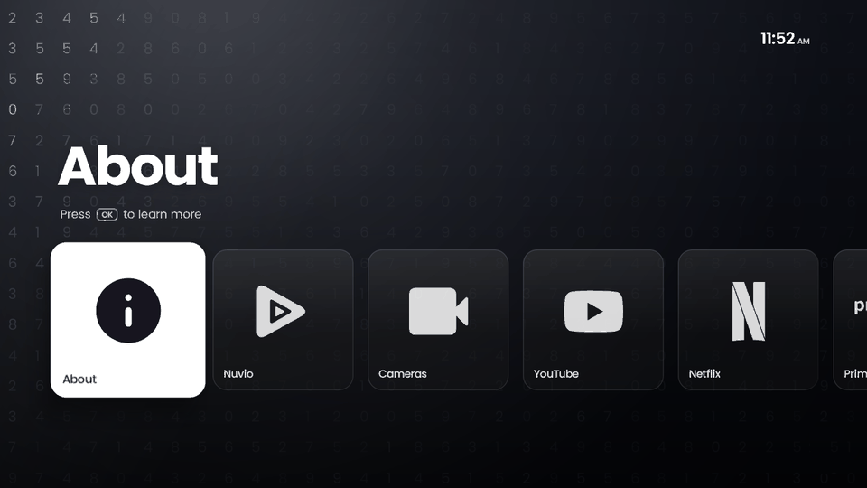

</div>

<br>

## Why

Stock TV launchers are loud: rows of ads, autoplaying trailers and "recommended for you" shelves. This launcher replaces all of that with a single row of large tiles over a living, full-screen background, inspired by the Frame TV look. It's built for a Xiaomi Mi TV (Android TV 9) and runs smoothly on its 1 GB of RAM.

## Features

<table>
<tr>
<td width="50%" valign="top">

### 🎨 A background for every tile
Each tile has its own hand-drawn motif. YouTube gets floating media icons, Netflix gets red light ribbons behind a giant N, Prime Video gets flowing lines, Cameras gets a viewfinder, and Nuvio gets its logo's triangles rippling out in a cyan-to-pink glow. Backgrounds cross-fade in 400 ms as you move.

</td>
<td width="50%" valign="top">

### 🌙 Night mode
Night mode runs automatically from 10 pm to 6 am, or you can set it to always on or off. Colours, glow and patterns dim so the screen is easy on your eyes in a dark room, and a small moon badge sits next to the clock.

</td>
</tr>
<tr>
<td valign="top">

### ✨ A living About screen
The **ⓘ** tile opens a guide to the launcher over a dark grid of random digits, with a wave of light sweeping across and lighting them up.

</td>
<td valign="top">

### 📺 Apps *and* inputs
Tiles open apps or switch straight to an HDMI input, for example a CCTV recorder on HDMI 2. **All apps** lists every installed TV app.

</td>
</tr>
<tr>
<td valign="top">

### ➕ Any app, your way
Add any installed app as a tile on the home row, or as a thin shortcut pill under it. Type its name with the built-in remote keyboard in **Launcher settings**. A **TV home** pill takes you to the TV's own home screen whenever you need it.

</td>
<td valign="top">

### ⚡ Fast on a modest TV
Gradients are drawn live on the GPU. Patterns are rendered once, off the main thread, into small alpha masks. The release build is minified. The home row runs at a p95 frame time of 73 ms and All apps scrolls at 46 ms on the Mi TV's txlx chip.

</td>
</tr>
<tr>
<td valign="top">

### 🏠 Truly your home
With the small **Home button** service switched on, the remote's Home button and the TV starting up both open this launcher instead of Google TV Home or PatchWall. Nothing is disabled or uninstalled.

</td>
<td valign="top">

### ⚙️ Its own settings
Press **Menu** for launcher settings: night mode and its hours, the night badge, reduce motion, home row apps, shortcuts, start-up and an option to open Cameras when the TV turns on. The Settings tile lets you choose launcher settings or the TV's own settings.

</td>
</tr>
</table>

## Screenshots

<table>
<tr>
<td>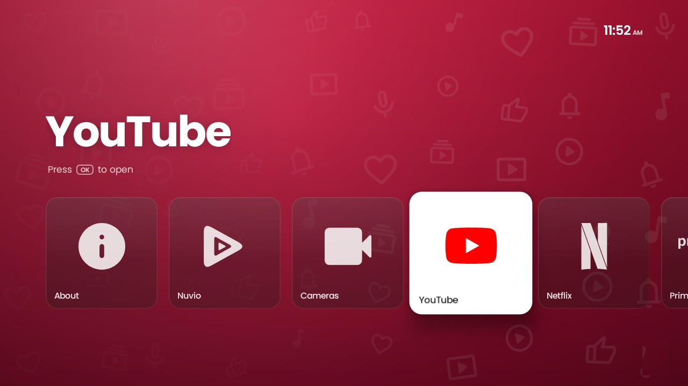</td>
<td>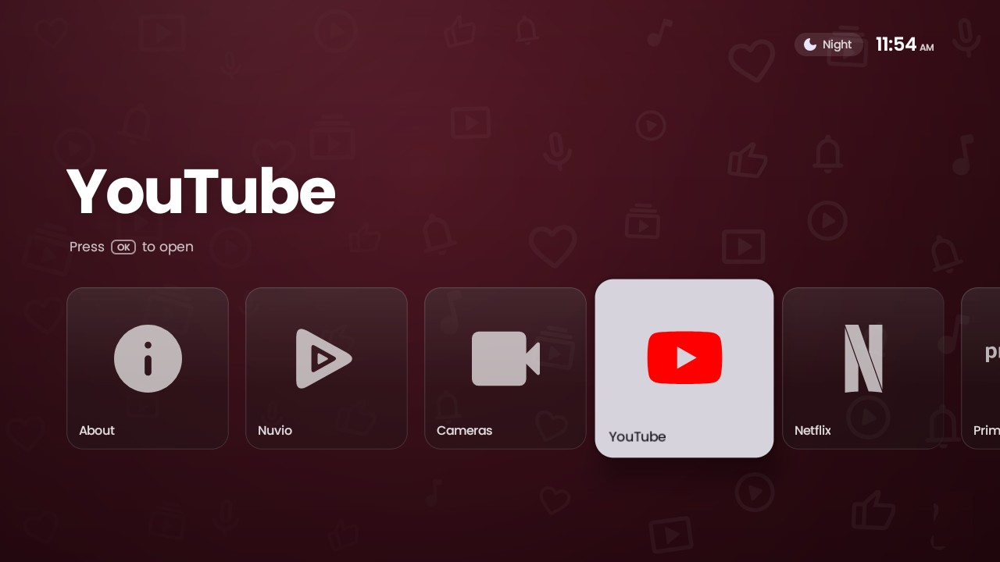</td>
</tr>
<tr>
<td align="center"><sub><b>Home</b>: YouTube selected</sub></td>
<td align="center"><sub><b>Night mode</b>: dimmed, with the moon badge</sub></td>
</tr>
<tr>
<td>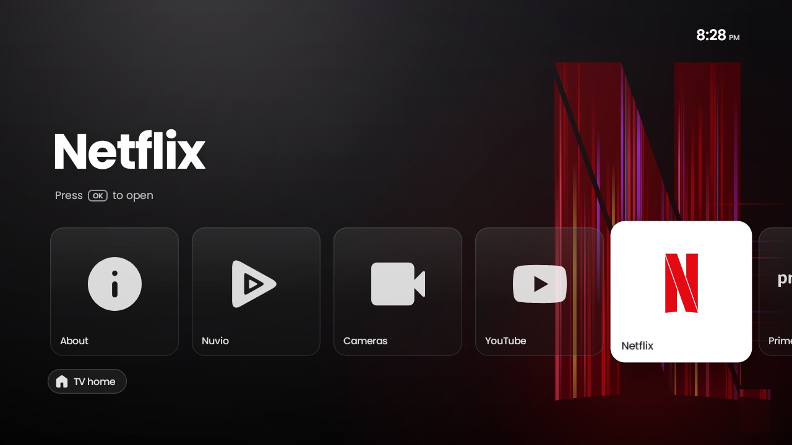</td>
<td>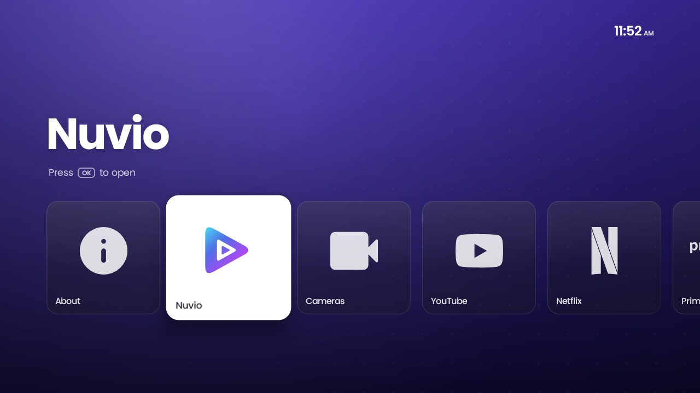</td>
</tr>
<tr>
<td align="center"><sub><b>Netflix</b>: light ribbons</sub></td>
<td align="center"><sub><b>Nuvio</b>: gradient mark on focus</sub></td>
</tr>
<tr>
<td>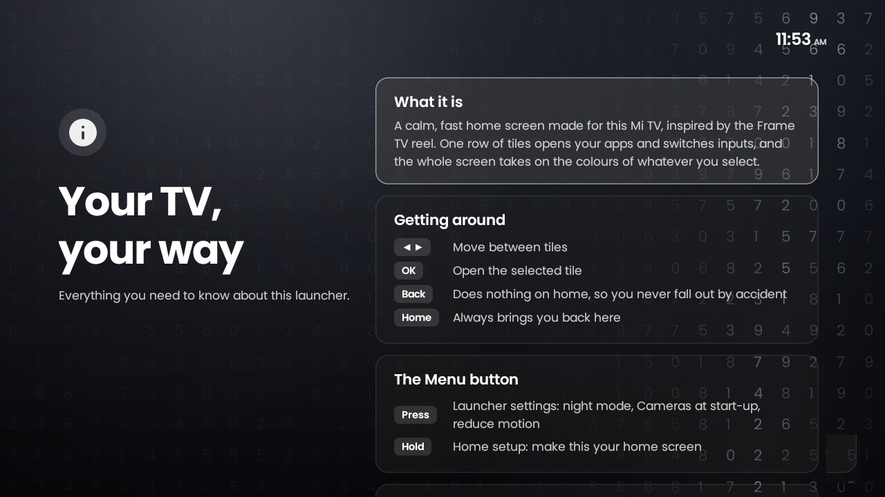</td>
<td>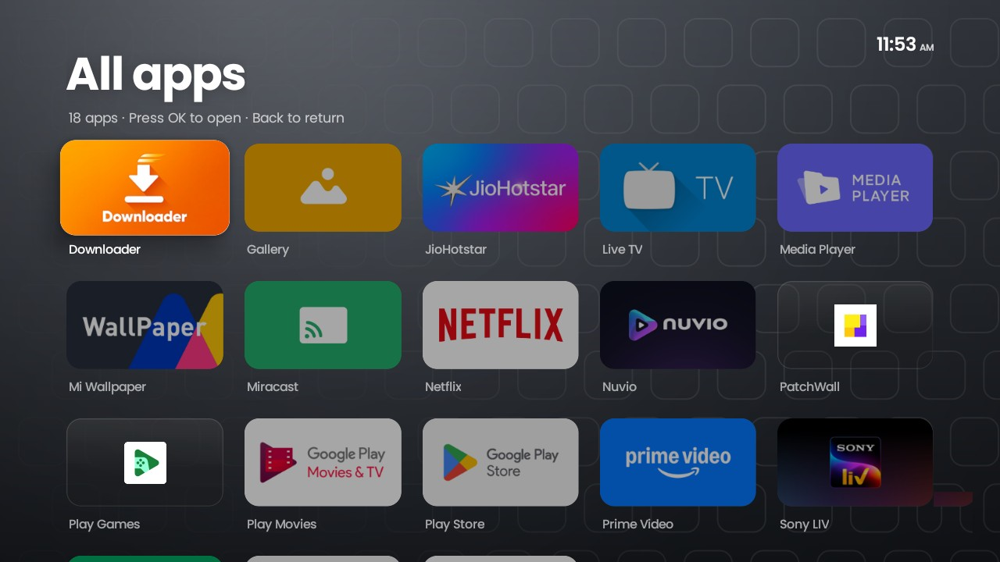</td>
</tr>
<tr>
<td align="center"><sub><b>About</b>: the light-wave grid</sub></td>
<td align="center"><sub><b>All apps</b></sub></td>
</tr>
<tr>
<td>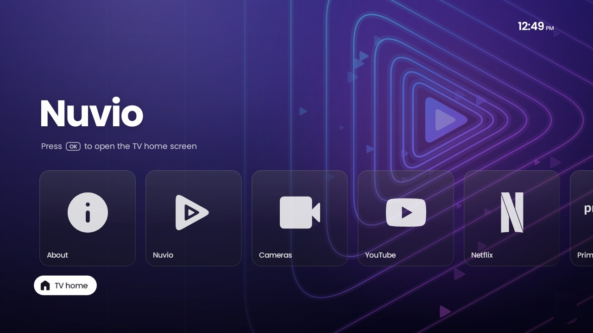</td>
<td>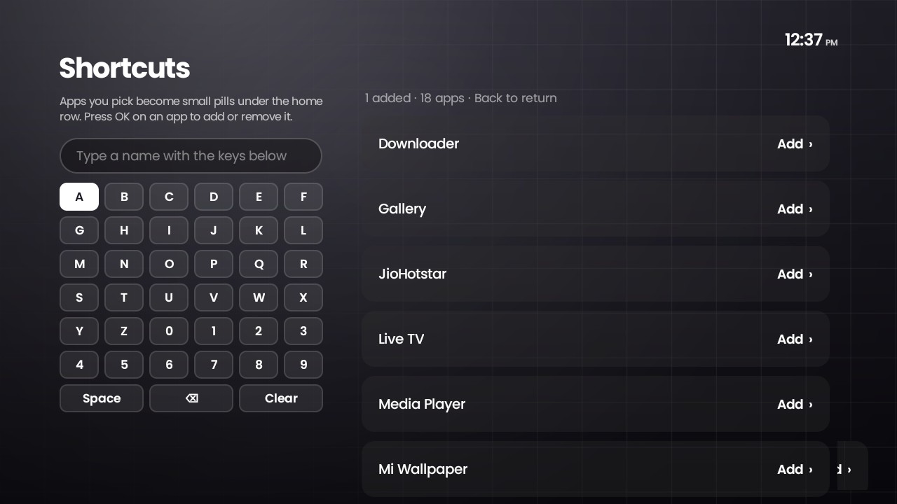</td>
</tr>
<tr>
<td align="center"><sub><b>Shortcut pills</b>: TV home and your apps</sub></td>
<td align="center"><sub><b>Add any app</b>: type with the remote</sub></td>
</tr>
<tr>
<td>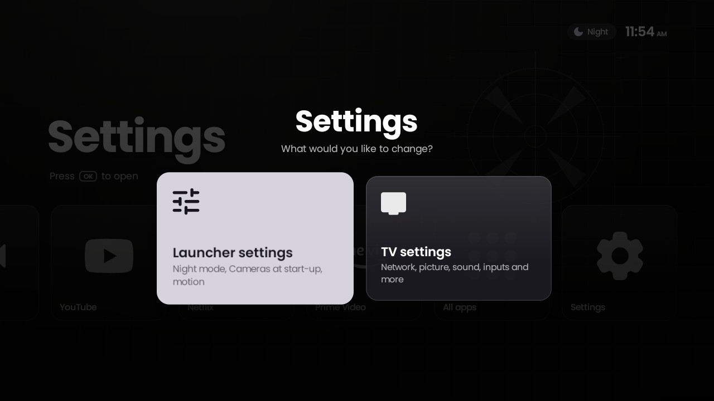</td>
<td>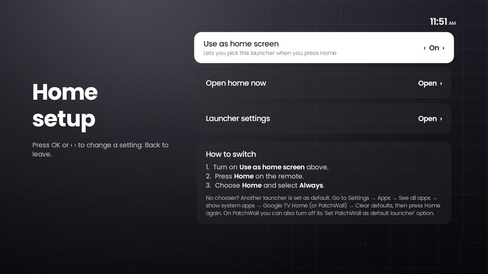</td>
</tr>
<tr>
<td align="center"><sub><b>Settings</b>: launcher or TV</sub></td>
<td align="center"><sub><b>Home setup</b></sub></td>
</tr>
</table>

## Remote controls

| Button | On the home screen |
|---|---|
| <kbd>◀</kbd> <kbd>▶</kbd> | Move between tiles |
| <kbd>OK</kbd> | Open the selected tile |
| <kbd>Back</kbd> | Does nothing, so you never fall out of home by accident |
| <kbd>▼</kbd> | Shortcut pills: TV home and the apps you added |
| <kbd>Home</kbd> | Brings you back home and closes any overlay. If you were already home, focus jumps to the first tile |
| <kbd>Menu</kbd> | Press: launcher settings · Hold: home setup |

## Install

You need the Android SDK and ADB, with network debugging turned on for the TV.

```bash
git clone https://github.com/AbhijotSingh2B/mitv-launcher.git
cd mitv-launcher
./gradlew assembleRelease
adb connect <tv-ip>:5555
adb install -r app/build/outputs/apk/release/app-release.apk
```

Then make the Home button open it. On many Android TVs, Google TV Home is a system app that always wins the Home button, so the launcher ships a tiny accessibility service for this:

1. On the TV, open **Settings → Device Preferences → Accessibility → Home button for Home launcher** and turn on **Enable**.
2. Optional, on Xiaomi TVs: in **Settings → Device Preferences → PatchWall**, turn off **Set PatchWall as default launcher**.

The service only sees button presses and which app is in front. It never reads what's on screen. While it's on, a held Home press is caught too, so the system's long-press Home action doesn't run. On TVs whose Home button already shows a chooser, you can instead open **Home Setup**, turn on **Use as home screen**, and pick **Always**. More detail, and how to undo it, is in [docs/SETUP-ON-TV.md](docs/SETUP-ON-TV.md).

## Make it yours

Everything on the home row comes from two small JSON files. No code changes are needed.

**[`tiles.json`](app/src/main/assets/tiles.json)**: which tiles appear, and in what order.

```json
[
  {"type":"info","theme":"info"},
  {"type":"app","package":"com.nuvio.app","label":"Nuvio","theme":"nuvio"},
  {"type":"hdmi","port":2,"label":"Cameras","theme":"purple"},
  {"type":"app","package":"com.google.android.youtube.tv","label":"YouTube","theme":"red"},
  {"type":"allApps","theme":"grey"},
  {"type":"settings","theme":"grid"}
]
```

**[`themes.json`](app/src/main/assets/themes.json)**: each theme's gradient, accent colour and background pattern.

```json
{"id":"red","top":"#D3173F","bottom":"#7E0A26","accent":"#FFFFFF","pattern":"doodles"}
```

The patterns are `doodles`, `ribbons`, `prism`, `lines`, `viewfinder`, `dots`, `tiles`, `rings`, `digits`, `lightgrid`, `grid` and `none`. An app that isn't installed is skipped, and a bad entry falls back to safe defaults.

## How it works

```
ui/       Compose for TV screens: home, All apps, About, settings, setup
  └── talks only to ──►  core/home/HomeController
core/     plain Kotlin: config parsing, app and HDMI catalogues, launching, settings
assets/   tiles.json and themes.json
```

- **The UI is swappable.** Screens only talk to `HomeController`, so the core can be unit-tested without a device.
- **HDMI switching** opens `TvContract.buildChannelUriForPassthroughInput(id)` with `ACTION_VIEW`.
- **Backgrounds**: gradient, glow and vignette are drawn live. Each pattern is rendered once on a background thread and cached for the whole app: an `ALPHA_8` mask tinted on the GPU, or a full-colour bitmap for `ribbons` and `prism`. The About screen's light wave is a `ComposeShader` that clips a moving gradient to the digit mask, and it animates only while that screen is on.
- **Being the home screen** is opt-in. The accessibility service catches short Home presses, and a boot receiver opens the launcher at start-up. Both are off until you switch them on, so installing the app never takes over your TV.

## Changing it with an AI agent

Most people who fork this will change it with an AI coding agent. [AGENTS.md](AGENTS.md) is written for them: the project map, the rules that keep it fast on a TV, step-by-step recipes (add a tile, a theme, a background pattern, a logo, a setting) and a done checklist. Point your agent at it first, or just ask it to "read AGENTS.md, then…".

## Tech

[Kotlin](https://kotlinlang.org) · [Jetpack Compose for TV](https://developer.android.com/training/tv/playback/compose) (`tv-material`) · kotlinx.serialization · AGP 9 · minSdk 28 / targetSdk 37 · JUnit tests for the core

```bash
./gradlew testDebugUnitTest   # core unit tests
./gradlew assembleRelease     # minified release APK
```

## Credits

- Design inspired by the Snazzy Labs Frame TV reel.
- [Poppins](https://fonts.google.com/specimen/Poppins) font (SIL OFL 1.1).
- Brand paths from [Simple Icons](https://simpleicons.org) (CC0), and UI icons from [Material Symbols](https://fonts.google.com/icons) (Apache 2.0).

Full details are in [licenses/NOTICE.md](licenses/NOTICE.md). YouTube, Netflix, Prime Video, Nuvio and their logos are trademarks of their owners. This project isn't affiliated with or endorsed by any of them.

## License

The code is [MIT](LICENSE). Third-party fonts and icons keep their own licences.

<div align="center"><sub>Built for one living room, shared in case it suits yours.</sub></div>
